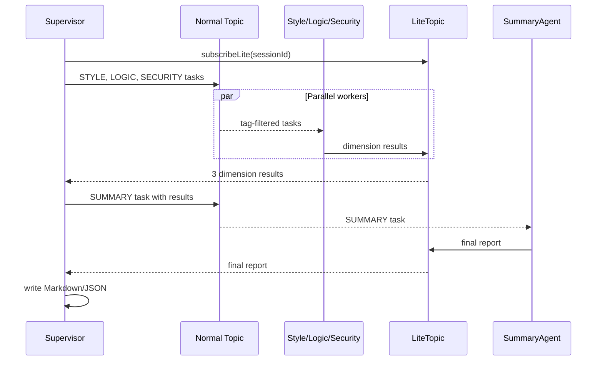

# Architecture

## Topology

```mermaid
flowchart LR
    CLI[SupervisorAgent] -->|STYLE / LOGIC / SECURITY / SUMMARY| T[(Normal Topic\nrmqai-{studentId}-review-task)]
    T --> S1[StyleAgent]
    T --> S2[LogicAgent]
    T --> S3[SecurityAgent]
    T --> S4[SummaryAgent]
    S1 --> L[(Lite parent Topic\nrmqai-{studentId}-review-result)]
    S2 --> L
    S3 --> L
    CLI -->|LitePushConsumer| L
    S4 --> L
    CLI --> R[reports/*.md / *.json]
```

## Topic plan

| Resource | Name | Purpose |
|---|---|---|
| Normal Topic | `rmqai-{studentId}-review-task` | Task dispatch, tag-filtered |
| Lite parent Topic | `rmqai-{studentId}-review-result` | Session-scoped results |
| Normal Groups | `GID_{studentId}_style/logic/security/summary` | Independent task consumers |
| Lite Group | `GID_{studentId}_supervisor` | Subscribes to the current session |

The four Worker groups subscribe to the same Normal Topic but different tags. The
Broker filters tags; each group has an independent offset. The Supervisor group is a
Lite group bound to the result parent Topic and dynamically subscribes to one
LiteTopic per review session.

## Message flow



## Naming and traceability

| Item | Format |
|---|---|
| Task key | `{studentId}_{sessionId}_{DIM}_REQ` |
| Result key | `{studentId}_{sessionId}_{DIM}_RES` |
| Session | `{studentId}-review-{yyyyMMdd-HHmmss}-{suffix}` |

Messages also carry `studentId`, `sessionId`, `dimension`, `stage`, `taskId` and
`agentId` properties. This allows console queries by key or message ID.

## SDK usage

- Tasks use the SDK's `RocketMQRequest` envelope.
- Results use the SDK's `RocketMQResponse` envelope.
- The Supervisor uses `RocketMQUtil.buildLitePushConsumer` and
  `LitePushConsumer.subscribeLite(sessionId)`.
- Request IDs use the SDK's `RequestIdGenerator`.

The project intentionally uses one Normal Topic plus tags rather than one topic per
Worker, and uses LiteTopic for session-scoped results rather than a shared normal
reply topic.

## Failure behavior

- A Worker exception becomes an `ERROR` result and is acknowledged, avoiding a
  poison-message loop.
- Missing dimension results are reported as missing; available results are still
  summarized.
- A Summary timeout produces a fallback report from the Supervisor.
- Results are deduplicated by dimension, rule ID and line.